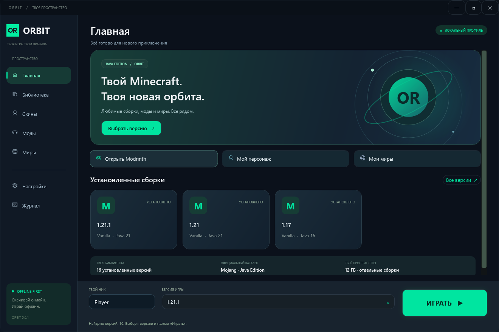

# ORBIT

Minecraft Java Edition launcher for Windows · **0.6.1 / early preview**

ORBIT — независимый лаунчер с локальными профилями, собственным интерфейсом и каталогом дополнений Modrinth. Написан на C# и WPF для .NET 8. Разрабатывается с помощью ИИ.



## Возможности

- Поиск установленных Vanilla, Fabric, Forge, NeoForge и Quilt-профилей.
- Скачивание Vanilla Minecraft, библиотек, ресурсов и необходимой Java с серверов Mojang.
- Локальный профиль с автосохранением ника и отдельные игровые папки для сборок.
- PNG-скины 64×64 / 64×32, модели Steve / Alex и поворачиваемый предпросмотр.
- Modrinth: поиск модов, ресурспаков и шейдеров, категории, сортировка и оригинальные иконки.
- Установка совместимых файлов с проверкой размера и SHA-512, обязательными зависимостями, прогрессом и отменой.
- Плавные переходы, реакции кнопок и режим уменьшения анимаций.

## Сборка

Нужны **Windows 10/11 x64** и **.NET 8 SDK**. Для восстановления пакетов нужен интернет. Отдельная установка Visual Studio не обязательна.

```powershell
dotnet build .\OrbitLauncher.csproj -c Release
```

Сборка автономного EXE вместе с лицензиями:

```powershell
powershell -ExecutionPolicy Bypass -File .\scriptsuild.ps1 -Publish
```

Результат: `artifacts/publish/win-x64/OrbitLauncher.exe`. Скрипт не запускает Minecraft. Подробности: [сборка и проверки](docs/BUILDING.md).

## Использование

1. Укажи папку Minecraft в настройках или выбери версию для скачивания.
2. Введи ник — он сохраняется автоматически. Выбери установленную версию и нажми «Играть».
3. В разделе «Моды» переключайся между модами, ресурспаками и шейдерами.
4. После установки включи ресурспак или шейдер через настройки самой игры.

Настройки и локальные данные: `%LOCALAPPDATA%/OrbitLauncher`. По умолчанию у каждой сборки отдельная игровая папка; существующие миры и моды автоматически не переносятся. Эти папки доступны из лаунчера.

## Ограничения

- Полноценный вход Microsoft пока не реализован. Локальный профиль не даёт доступ к серверам, требующим официальной проверки аккаунта.
- Установка новых Fabric/Forge/NeoForge/Quilt через лаунчер пока не реализована; используются уже установленные профили.
- Для модов нужен соответствующий загрузчик. Для шейдеров нужен совместимый Iris или OptiFine: скачивание ZIP не устанавливает загрузчик.
- Совместимость подбирается по метаданным Modrinth и не гарантирует отсутствие конфликтов с модами, добавленными вручную.
- Локальный скин автоматически не становится видимым другим игрокам. Сторонние системы скинов могут конфликтовать.
- Это предварительная версия. Перед открытием важных миров в другой версии Minecraft сделай резервную копию.

## Авторство

- **Автор и владелец проекта:** [siho2223](https://github.com/siho2223).
- **Помощь в разработке, тестировании и документации:** OpenAI Codex.

ORBIT создан по идеям и под руководством автора с использованием ИИ-инструментов. Это не официальный проект OpenAI.

## Исходники и лицензии

Код ORBIT распространяется по **GPL-3.0-only**: [LICENSE](LICENSE). У сторонних компонентов собственные лицензии: [NOTICE](NOTICE.md) и [ThirdParty](ThirdParty).

В исходники включён неизменённый authlib-injector 1.2.8 вместе с его точным исходным архивом и лицензией. Minecraft, Java, моды, ресурспаки, шейдеры, пользовательские скины и игровые сохранения не включены.

ORBIT не связан с Mojang, Microsoft или Modrinth. Названия продуктов и изображения проектов принадлежат их владельцам.

[Архитектура](docs/ARCHITECTURE.md) · [Участие в разработке](CONTRIBUTING.md) · [История изменений](CHANGELOG.md)

[Как загрузить этот проект на GitHub](docs/PUBLISHING.md) · [Проверка подготовленных исходников](docs/VERIFICATION.md)
