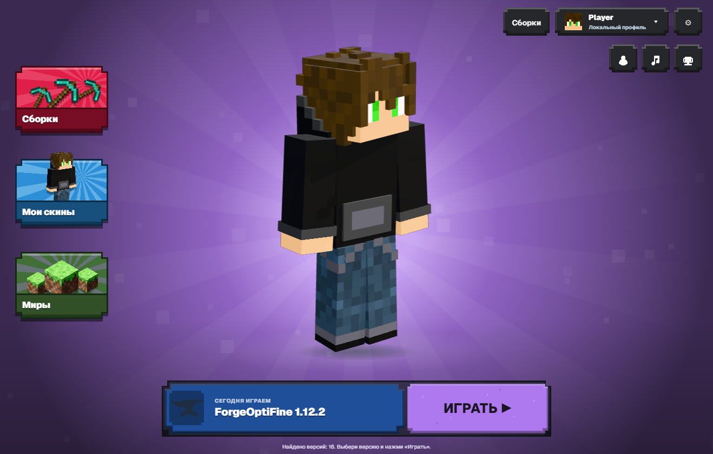
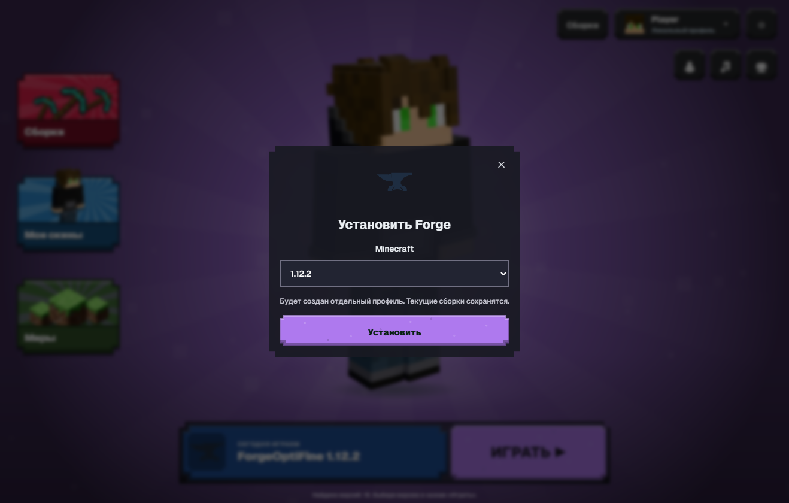

# ORBIT Launcher

Minecraft Java launcher for Windows · **0.12.3 / preview**

ORBIT is an independent C# / WPF launcher for .NET 8, built with assistance from OpenAI Codex.



## Interface preview (0.12.0)

**Default** is the game lobby (formerly Brawl Stars), with five palettes, Mine3D character preview, drag rotation and emotes. **Old theme** is the previous XMCL-based interface. Existing settings migrate to the new Default once; subsequent theme choices are retained. Internal legacy theme IDs are kept for settings compatibility.


Forge profiles use an anvil and light grey cards; Fabric uses the official logo and brown cards. Other installed profiles are green. The same identity appears in the library, version picker and labelled Old theme instance rail. The rail shows all installed versions, not only the first twelve.

Forge/Fabric quick installation is available from the version picker and library (Default) or version picker (Old theme). Choose Minecraft and install: ORBIT provisions Vanilla and required Java, installs the loader in a private staging directory, then publishes libraries and profile. Existing profiles/content are preserved. Live tests verified Forge 52.1.0 and Fabric 0.19.5 for Minecraft 1.21.1. Arbitrary older Forge installers are not guaranteed to support unattended installation.



Profiles are local/offline. Microsoft sign-in buttons were removed, and Discord sign-in was deferred at the project owner's request because no authorization server is available. No Discord secret or server configuration is requested from players.

The lobby uses actual Millida pixel CSS, adapted HubTile/Play structure and Mine3D via a local WebView2 interface. Proprietary Millida artwork/services are excluded; left tiles use Minecraft/user-skin imagery. Microsoft Edge WebView2 Runtime is required; the previous native interface is used as fallback if the runtime is unavailable. Runtime game textures are not bundled.

Developer frontend rebuild: `npm ci --prefix BrawlUI --ignore-scripts` followed by `npm --prefix BrawlUI run build`. Generated dist is embedded in the executable; node_modules is excluded from source packages.

## Features

- Two live themes in Settings → Appearance: Default (game lobby) and Old theme (XMCL-based). Original source attribution and licenses are retained in ThirdParty.
- English by default, with a live English / Russian switch in Settings.
- Download Vanilla Minecraft, libraries, assets and required Java from Mojang.
- Discover existing Vanilla, Fabric, Forge, NeoForge and Quilt profiles.
- Install Modrinth modpacks as independent, launchable library entries. The MRPACK installer provisions the exact declared Minecraft and loader versions.
- Search and install Modrinth mods, resource packs and shaders, with categories, icons, SHA-512 verification, required mod dependencies and cancellation.
- Open each instance folder from its library card or the folder icon beside the selected version. Settings also has direct instance, mods and Minecraft root folder buttons.
- Offline nickname with autosave; local PNG skins (64×64 / 64×32) and named skin presets with classic / slim arms, front-facing character cards and one-click selection.
- Close the Minecraft process launched by ORBIT using the main button. Requests normal shutdown first; forced termination requires a separate confirmation.
- Configure game window resolution, fullscreen, minimize-on-launch, memory, Java, animation reduction, launcher window size persistence and log scrolling.
- Catalog search works independently of category metadata, rejects stale responses after tab changes, retries transient API failures and offers a retry button.
- Saved skin cards apply immediately without scrolling the page. The named dropdown also selects a saved skin; only the delete action remains below it.
- Skin previews keep an opaque base layer and render cutout overlays without erasing neighboring limbs. Legacy skins mirror their left limbs correctly.
- Drag the lobby character with the left mouse button to rotate it. Wave, dance and cheer animations are available; reduced motion disables them.
- The Brawl theme uses original Minecraft item icons loaded read-only from an installed client JAR: diamond pickaxe, armor stand, complete grass-block window icon, totem, music disc and firework rocket. No game assets are bundled. Settings, Back and Library retain their familiar cog, arrow and grid icons. Embedded Kenney CC0 icons provide a fallback until a client is installed.
- Click the version button again to close the picker; outside clicks and Escape also close it.
- Hover feedback stays within card bounds; usable scrollbars and taskbar-aware maximization.

## Build

Windows 10/11 x64 and the .NET 8 SDK are required. Internet is needed to restore packages.

```powershell
.\scripts\build.ps1 -Test -Publish
```

Published launcher: `artifacts/publish/win-x64/OrbitLauncher.exe`. The self-contained build includes .NET. Build scripts do not start Minecraft.

To build the installer, install [Inno Setup 6.7.3 or newer](https://jrsoftware.org/isdl.php), then:

```powershell
.\scripts\build-installer.ps1 -Iscc 'C:\Program Files (x86)\Inno Setup 6\ISCC.exe'
```

Installer EXE and SHA-256: `artifacts/installer`. More: [building](docs/BUILDING.md), [architecture](docs/ARCHITECTURE.md), [validation](docs/VERIFICATION.md).

## Storage and first launch

A fresh profile uses `%APPDATA%\.minecraft`. ORBIT creates this folder if it does not exist; Minecraft versions, libraries, assets and runtime are downloaded when a version is installed. Choose an existing game folder in Settings to use existing profiles. Existing user settings are preserved when upgrading.

Standard isolated instances: `%LOCALAPPDATA%\OrbitLauncher\instances\<id>`.

Modrinth packs: `%LOCALAPPDATA%\OrbitLauncher\modpacks\<id>`. These remain independent even when standard instance isolation is disabled. Mods, resource packs, shaders and worlds go into `mods`, `resourcepacks`, `shaderpacks` and `saves` within the selected game folder.

Skin presets: `%LOCALAPPDATA%\OrbitLauncher\skin-presets`.

## Current limits

Preview software. Account profiles are local/offline. Microsoft and Discord login are not offered in this build; online-mode Minecraft servers require official account authentication. A local skin is not automatically visible to other players.

A shader ZIP does not install Iris or OptiFine. Installing individual mods requires a compatible existing loader profile. MRPACK modpacks provision their own declared Fabric, Quilt, Forge or NeoForge loader. The current pack catalog installs the latest published release; optional client files are included, server-only files are skipped. Unsupported dependencies or download hosts stop installation with an error instead of publishing an incomplete pack. Old Java 8 Forge installers may not support unattended installation.

The installer is unsigned. A Windows unknown-publisher warning is possible. No telemetry or updater is included. Uninstalling the application preserves game files and user data.

## Русский

Русский язык включается в **Settings → Interface language → Русский**. Скачивание сборок Modrinth находится во вкладке **Моды → Сборки**. Папка у карточки версии открывает игровую папку сборки. Скины можно сохранять как именованные шаблоны и переключать вместе с моделью рук.

Темы доступны в **Настройки → Оформление**. Для Default доступен выбор палитры. Карточка сохранённого скина применяет его без прокрутки страницы.

## Authors and license

- Project author and owner: [siho2223](https://github.com/siho2223) / Telegram [@farzix0](https://t.me/farzix0).
- Development, testing and documentation assistance: OpenAI Codex. This is not an official OpenAI project.

ORBIT source: **GPL-3.0-only**, see [LICENSE](LICENSE). Dependencies retain their licenses; see [NOTICE.md](NOTICE.md) and `ThirdParty`. Unmodified authlib-injector 1.2.8 and its exact source archive are included with its AGPLv3+ license and bundling exception. SkiaSharp and .NET/WPF notices are included.

No Minecraft, modpack or other game assets, Java runtime, credentials or user settings are included in this source repository. The OR icon was generated with AI at the author's request. ORBIT is not affiliated with Mojang or Microsoft.

### Export a modpack ZIP

In Library, click **Export ZIP** on the installed instance card and choose where to save it. ORBIT packages mods, config/defaultconfigs, shaderpacks, resourcepacks, scripts, kubejs, crafttweaker, patchouli_books and game graphics options. Worlds, screenshots, accounts, logs, Minecraft binaries and Java are excluded. Close the game and finish installations before exporting. Progress and cancellation are available in Library.

The ZIP includes `orbit-pack.json` with Minecraft, loader and exact profile details, and `README.txt`. This is a content archive, not an automatically importable `.mrpack`/CurseForge pack. The recipient installs the matching game and loader, then copies the contents of `overrides` into that instance folder.
